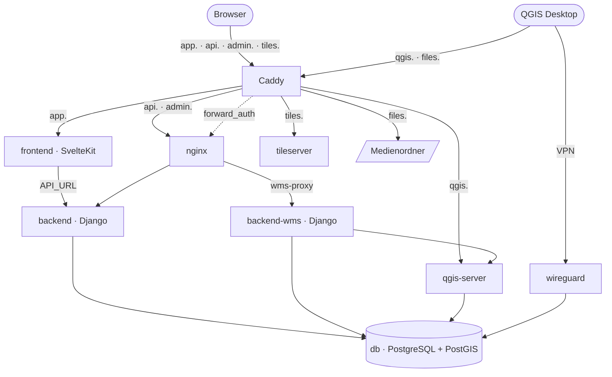

# 29. Architekturüberblick

Dieses Kapitel beschreibt, aus welchen Teilen Qonnectra besteht, welchen Weg eine Anfrage durch sie nimmt und wo im Repository was liegt. Es ist der Einstieg in Teil C; die folgenden Kapitel vertiefen je einen Teil. Welche Dienste eine Installation betreibt und wofür, steht bereits in Kapitel [Betrieb der Instanz](../teil-b-betrieb-admin-qgis/28-betrieb-der-instanz.md) – dieses Kapitel setzt die Tabelle dort voraus und wiederholt sie nicht.

Die Angaben beziehen sich auf die jeweils aktuelle Veröffentlichung von Qonnectra.

## 29.1 Komponenten und Weg einer Anfrage

Qonnectra besteht aus drei eigenen Teilen und einer Reihe fertiger Dienste:

- **Backend** – eine Django-Anwendung mit Django REST Framework. Sie stellt die Schnittstelle unter `/api/v1/` und den Administrationsbereich bereit, enthält die Fachlogik (Routing, Faserweg, Störungsanalyse, Wertermittlung) und erzeugt die Vektorkacheln der Netzobjekte.
- **Frontend** – eine SvelteKit-Anwendung, die die Weboberfläche ausliefert. Sie läuft als eigener Node-Prozess, rendert Seiten auf dem Server vor und spricht dafür selbst mit dem Backend.
- **Datenbank** – PostgreSQL mit PostGIS. Ein Teil der Fachlogik liegt als Trigger in der Datenbank selbst, siehe Kapitel [Datenmodell des Backends](./31-datenmodell-des-backends.md).

Dazu kommen die fertigen Dienste aus der Tabelle in Abschnitt [Systemüberblick](../teil-b-betrieb-admin-qgis/28-betrieb-der-instanz.md#_28-1-systemuberblick-dienste-und-ihre-aufgaben).

Eine Installation hat sechs Adressen. Caddy nimmt alle Anfragen an, beendet TLS und verteilt sie nach Adresse:

| Adresse | Ziel | Prüfung vor der Weiterleitung |
|---|---|---|
| `APP_DOMAIN` | `frontend:3000` | keine, das Frontend prüft selbst |
| `API_DOMAIN` | `nginx:80` → `backend` | keine; `/admin/*` beantwortet Caddy hier mit 404 |
| `ADMIN_DOMAIN` | `nginx:80` → `backend` | keine, der Administrationsbereich hat eine eigene Anmeldung |
| `FILES_DOMAIN` | WebDAV-Modul von Caddy auf dem Medienordner | `forward_auth` gegen `/api/v1/auth/webdav-auth/` |
| `QGIS_DOMAIN` | `qgis-server:80` | `forward_auth` gegen `/api/v1/auth/qgis-auth/` |
| `TILE_SERVER_DOMAIN` | `tileserver:8080` | keine |

Backend und Administrationsbereich sind derselbe Prozess unter zwei Adressen. Die Trennung entsteht nur dadurch, dass Caddy `/admin/*` auf der Adresse der Schnittstelle sperrt.



Für die Weboberfläche gibt es zwei Wege zum Backend, und welcher genommen wird, hängt davon ab, wo der Code läuft:

- **Auf dem Server.** Lade-Funktionen, Formularaktionen und Remote Functions des Frontends laufen im Container `frontend` und erreichen das Backend über `API_URL` direkt im Docker-Netz (`http://backend:8000/api/v1/`), an Caddy und nginx vorbei. Die Anmelde-Cookies des Browsers reicht das Frontend dabei weiter.
- **Im Browser.** Alles, was die Seite nach dem Laden selbst holt – Vektorkacheln der Karte, WMS-Bilder, Suchtreffer, Speichervorgänge –, geht über `PUBLIC_API_URL` an die Adresse der Schnittstelle, also durch Caddy und nginx. Die Cookies gelten für alle Adressen der Installation, weil sie auf die gemeinsame Domain gesetzt werden (`COOKIE_DOMAIN`).

Wie die Anmeldung über beide Wege funktioniert und wann das Frontend die Tokens erneuert, beschreiben die Kapitel [REST-API](./32-rest-api.md) und [Frontend](./33-frontend.md).

nginx ist mehr als eine Weiterleitung. Es liefert die statischen Dateien des Administrationsbereichs aus, gibt Anhänge erst aus, nachdem das Backend den Zugriff geprüft und per `X-Accel-Redirect` freigegeben hat, und hält zwei Zwischenspeicher: Vektorkacheln der Netzobjekte für 30 Sekunden, WMS-Bilder für 30 Tage. Die WMS-Anfragen gibt es an `backend-wms` weiter, dasselbe Image mit eigenem Prozesspool.

Die Karte der Weboberfläche setzt sich aus drei Quellen zusammen, die nichts miteinander zu tun haben:

- **Hintergrundkarte** – Vektorkacheln von TileServer GL unter `TILE_SERVER_DOMAIN`, aus einer `.mbtiles`-Datei. Ohne sie fällt die Karte auf OpenStreetMap-Rasterkacheln zurück.
- **Netzobjekte** – Trassen, Netzknoten, Adressen und Gebiete als Vektorkacheln, die das Backend pro Anfrage in PostGIS erzeugt (`/api/v1/ol_*_tiles/`).
- **WMS-Ebenen** – Bilder des eigenen QGIS Servers oder externer Dienste, abgerufen über den WMS-Proxy des Backends.

::: info
Holt das Backend die Fähigkeiten eines WMS von der eigenen `QGIS_DOMAIN`, schreibt es die Adresse auf `http://qgis-server` im Docker-Netz um. Über die öffentliche Adresse liefe die Anfrage durch die Anmeldeprüfung von Caddy zurück an das Backend selbst und bliebe hängen.
:::

## 29.2 Technologiestack

Die Versionen sind die der Sperrdateien (`backend/uv.lock`, `frontend/package-lock.json`) und der Container-Images zum Stand des Handbuchs.

::: warning
Das Image des Backends hält sich nicht an `backend/uv.lock`. Sein Dockerfile installiert mit `pip install .` die jeweils neuesten Versionen innerhalb der Grenzen aus `backend/pyproject.toml`; was im Container läuft, hängt deshalb vom Tag des Builds ab. Ein im Oktober 2026 gebautes Image enthielt etwa Django 5.2.17, Django REST Framework 3.18.1 und gunicorn 26.2.0 statt der Versionen der Tabelle. Die Tabelle gilt für die Entwicklungsumgebung, die `uv sync` aus der Sperrdatei einrichtet. Das Frontend baut dagegen mit `npm ci` genau nach `package-lock.json`.
:::

**Backend**

| Baustein | Version | Aufgabe |
|---|---|---|
| Python | 3.12 | Laufzeit, Image `python:3.12-slim` |
| Django | 5.2.10 | Webframework, Administrationsbereich, ORM mit GeoDjango |
| Django REST Framework | 3.15.2 | Schnittstelle |
| djangorestframework-gis | 1.1 | Geometrien in Serialisierern |
| dj-rest-auth, djangorestframework-simplejwt | 7.0.1, 5.5.0 | Anmeldung mit JWT in Cookies |
| drf-spectacular | 0.30.0 | OpenAPI-Schema |
| django-simple-history | 3.11.0 | Änderungsverlauf |
| networkx | 3.5 | Graphen für Routing und Kabellängen |
| GeoPandas | 1.1.0 | GeoPackage-Erzeugung |
| psycopg | 3.2.6 | Datenbanktreiber |
| gunicorn | 23.0.0 | Anwendungsserver |

**Frontend**

| Baustein | Version | Aufgabe |
|---|---|---|
| Node.js | 22 | Laufzeit, Image `node:22-alpine`, `@sveltejs/adapter-node` |
| Svelte, SvelteKit | 5.56.10, 2.66.0 | Oberfläche und Server-Rendering |
| Vite | 8.0.16 | Build |
| TypeScript | 5.9.3 | Typprüfung |
| OpenLayers, ol-mapbox-style | 10.7.0, 13.2.0 | Karte und Hintergrundkarte |
| Svelte Flow (`@xyflow/svelte`) | 1.6.5 | Netzschema, Rohrverzweigung und Grabenprofil |
| Chart.js | 4.5.1 | Diagramme des Dashboards |
| Skeleton, Tailwind CSS | 5.0.1, 4.3.1 | Komponenten und Gestaltung |
| Paraglide | 2.12.0 | Übersetzungen |

**Dienste**

| Dienst | Image |
|---|---|
| Datenbank | eigenes Image auf Basis von `postgis/postgis:17-3.5` (PostgreSQL 17, PostGIS 3.5, pgRouting) |
| QGIS Server | `qgis/qgis-server:3.44.7-noble` |
| Hintergrundkarte | `maptiler/tileserver-gl:v5.6.0` |
| Reverse Proxy | eigenes Image auf Basis von `caddy:2` mit dem Modul `caddy-webdav` |
| Vorstufe des Backends | `nginx:stable-alpine` |
| VPN | `lscr.io/linuxserver/wireguard:latest` |

::: info
pgRouting ist im Datenbank-Image installiert, wird aber nicht genutzt. Routing und Kabellängen berechnet das Backend in Python mit networkx.
:::

## 29.3 Verzeichnisstruktur des Repositorys

Das Repository [Geodock-GmbH/Qonnectra](https://github.com/Geodock-GmbH/Qonnectra) enthält Backend, Frontend und Bereitstellung in einem:

```text
backend/
  apps/api/          die einzige Django-App: Modelle, Schnittstelle, Fachlogik
    fixtures/        Stammdaten für load_initial_data
    management/      Verwaltungsbefehle
    migrations/      Migrationen, viele davon mit SQL für Trigger
    tests/           pytest-Tests
  core/              Projektpaket: settings.py, urls.py, wsgi.py, asgi.py
  locale/            Übersetzungen des Backends (gettext)
  templates/         Vorlagen des Administrationsbereichs
  schema.yml         OpenAPI-Schema, Quelle der Frontend-Typen
frontend/
  src/routes/        eine Route je Menüpunkt, dazu login, logout, admin/logs
                     und api (Server-Endpunkte)
  src/lib/           classes, components, config, context, map, remote,
                     server, stores, test-utils, types, utils
  messages/          Texte der Oberfläche, de.json und en.json
  project.inlang/    Einstellungen von Paraglide
  tests/e2e/         Playwright-Tests
deployment/
  docker-compose.yml       Produktion
  docker-compose.dev.yml   Entwicklung mit lokalem HTTPS (startet nicht, siehe 30.4)
  Caddyfile, Caddyfile.production
  nginx/, postgres/, qgis/, tiles/, caddy/, wireguard/, backup/
.github/workflows/   CI des Frontends, Playwright, release-please
pytest.ini           Testkonfiguration des Backends
```

Die Fachlogik des Backends ist auf wenige große Module verteilt: `views.py` enthält die Endpunkte, `services.py` Faserweg, Signalanalyse, Störungsanalyse und Wertermittlung sowie Excel-Import, GeoPackage-Erzeugung und Dateiablage, `routing.py` das Routing über networkx, `search.py` die Ähnlichkeitssuche, `wms_service.py` den WMS-Proxy.

Im Frontend liegen Komponenten, die nur eine Ansicht braucht, neben ihrer Route in `src/routes/`; was mehrere Ansichten teilen, liegt in `src/lib/`.

## 29.4 Lizenz, Herkunft und Beteiligte

Qonnectra steht unter der **GNU Affero General Public License, Version 3** (`AGPL-3.0-only`). Die AGPL verlangt über die GPL hinaus, dass jede Stelle, die eine veränderte Fassung als Netzdienst betreibt, den Nutzenden dieses Dienstes deren Quelltext zugänglich macht.

Entwickelt wird Qonnectra von der Geodock GmbH gemeinsam mit der plan[neo] GmbH; das Repository gehört der Geodock GmbH. Die Ansprechpersonen für die Pflege stehen in `publiccode.yml` im Wurzelverzeichnis, einer maschinenlesbaren Beschreibung nach dem Standard [publiccode.yml](https://yml.publiccode.tools/) für Software der öffentlichen Hand. Wie Beiträge, Versionen und Veröffentlichungen ablaufen, beschreibt Kapitel [Erweitern und mitwirken](./36-erweitern-und-mitwirken.md).
