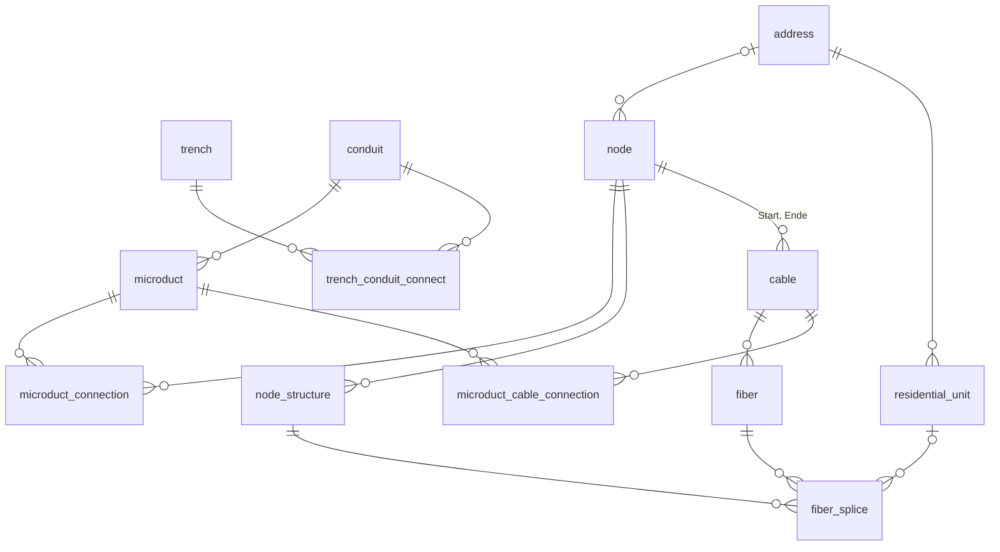

# 31. Datenmodell des Backends

Dieses Kapitel beschreibt die Tabellen hinter den Fachobjekten, wie sie zusammenhängen und welche Regeln die Datenbank selbst durchsetzt. Was die Objekte fachlich bedeuten, erklärt Kapitel [Grundbegriffe und Datenmodell](../teil-a-anwenderhandbuch/02-grundbegriffe-und-datenmodell.md); dieses Kapitel setzt es voraus.

Alle Modelle stehen in einer einzigen Django-App, `apps/api`, in der Datei `backend/apps/api/models.py`. Ein Modell entspricht einer Tabelle; die Tabellennamen sind fest vergeben (`db_table`) und tragen kein App-Präfix – das Modell `Trench` liegt in der Tabelle `trench`, `TrenchConduitConnection` in `trench_conduit_connect`. Unter diesen Namen sehen auch QGIS und jedes andere Werkzeug mit Datenbankzugang die Daten.

Die Netzobjekte und ihre Verknüpfungen im Überblick, mit den Tabellennamen:



## 31.1 Projekt und Kennzeichen als Ordnungsrahmen

Zwei kleine Tabellen ordnen alle Netzdaten: `projects` (Spalten `id`, `project`, `description`, `active`) und `flags` (`id`, `flag`). Beide haben eine fortlaufende Ganzzahl als Schlüssel; die Nummer 1 trägt jeweils der Eintrag „Default“ aus den Fixtures, siehe Abschnitt [Stamm- und Ausgangsdaten laden](./30-entwicklungsumgebung.md#_30-6-stamm-und-ausgangsdaten-laden).

Die Fachobjekte der obersten Ebene tragen beide als Fremdschlüssel, in den Spalten `project` und `flag`: `trench`, `conduit`, `cable`, `node`, `address` und `area`, dazu `fiber`, das die Werte seines Kabels wiederholt. Alles darunter – Mikrorohre, Wohneinheiten, Spleiße, die Struktur eines Netzknotens – gehört über sein übergeordnetes Objekt zu einem Projekt und hat keine eigene Spalte dafür.

Ein **Kennzeichen** ist nicht an ein Projekt gebunden. `flags` ist eine einzige Liste für die ganze Installation, und jedes Objekt wählt daraus unabhängig von seinem Projekt.

Eindeutig sind die Namen der Objekte innerhalb eines Projekts:

| Tabelle | eindeutig über |
|---|---|
| `trench` | `project`, `id_trench` |
| `address` | `project`, `id_address` |
| `conduit`, `node`, `area` | `project`, `name` |
| `cable` | `name` – über **alle** Projekte hinweg, zusätzlich zu `project`, `name` |

Der Kabelname ist die Ausnahme: Ein Kabel „K-001“ kann es in der ganzen Installation nur einmal geben.

Projektbezogene Einstellungen hängen ebenfalls an `projects`: `network_schema_settings` und `pipe_branch_settings` mit dem Projekt als Primärschlüssel, also genau einem Eintrag je Projekt, sowie `valuation_cost_rate` und `wms_source` mit beliebig vielen. Was sie bewirken, beschreibt Kapitel [Projektbezogene Konfiguration](../teil-b-betrieb-admin-qgis/22-projektbezogene-konfiguration.md).

## 31.2 Geometriemodelle und SRID

Vier Tabellen der Netzdaten haben eine Geometrie, dazu die Auskunftsbereiche der Leitungsauskunft:

| Tabelle | Geometrie |
|---|---|
| `trench` | `LineString` |
| `node`, `address` | `Point` |
| `area`, `pipeline_inquiry_area` | `Polygon` |

Kabel und Rohre haben keine eigene Geometrie. Ihr Verlauf ergibt sich aus den Trassen, denen sie zugeordnet sind; Faserweg und Feature-Export setzen ihn bei Bedarf aus deren Geometrien zusammen.

Jede dieser Tabellen hat zwei Geometriespalten:

- **`geom`** im Koordinatenbezugssystem der Installation. In ihr wird erfasst und gerechnet: Längen, Abstände, die Fünf-Meter-Prüfung der Mikrorohrverbindungen.
- **`geom_3857`** in Web Mercator (EPSG:3857), eine von PostgreSQL berechnete Spalte (`GENERATED ALWAYS AS … STORED`). Aus ihr erzeugt das Backend die Vektorkacheln der Karte, ohne bei jeder Anfrage umzurechnen. Sie lässt sich nicht schreiben; in Django ist sie ein `GeneratedField`, im Änderungsverlauf fehlt sie.

Das Koordinatenbezugssystem von `geom` liest das Backend aus `DEFAULT_SRID`, Vorgabe ist 25832 (ETRS89 / UTM Zone 32N).

::: warning
Andere Werte als 25832 unterstützt Qonnectra zum Stand des Handbuchs nicht durchgängig, auch wenn die `README.md` des Repositorys 25833 nennt. Die Migrationen legen die Geometriespalten fest mit 25832 an, unabhängig von `DEFAULT_SRID`. Mit `DEFAULT_SRID=25833` meldet `makemigrations` auf einer frisch migrierten Datenbank zehn geänderte Felder, und an einzelnen Stellen im Code steht 25832 ohne Bezug auf die Einstellung. Eine Installation für Zone 33 braucht deshalb eigene Migrationen und eine Prüfung dieser Stellen. Auf einer Installation mit Daten darf sich der Wert ohnehin nie ändern, siehe Abschnitt [Konfiguration über Umgebungsvariablen](../teil-b-betrieb-admin-qgis/28-betrieb-der-instanz.md#_28-2-konfiguration-uber-umgebungsvariablen).
:::

Ungültige Geometrien weist die Datenbank zurück. Ein Trigger auf `trench` verlangt eine gültige und einfache Linie – ohne Selbstüberschneidung –, einer auf `area` ein gültiges und einfaches Polygon. Die Fehlermeldung nennt bei einer sich selbst schneidenden Trasse und bei jedem abgewiesenen Gebiet den Mittelpunkt sowie Länge bzw. Fläche, damit sich die Stelle finden lässt.

## 31.3 Trasse, Rohr, Mikrorohr und ihre Verknüpfungen

**`trench`** ist die Trasse: Geometrie, Bauart, Oberfläche, Status, Phase, Eigentümer und Baufirma, Verlegetiefe, Datum. Der Primärschlüssel ist eine UUID (`uuid`), die sichtbare Kennung steht in `id_trench`, siehe Abschnitt [Migrationen, Datenbank-Trigger und Signale](#_31-9-migrationen-datenbank-trigger-und-signale). `length` berechnet ein Trigger bei jedem Speichern aus der Geometrie; ein Wert, der von außen kommt, wird überschrieben.

**`conduit`** ist das Rohr. Es hat keinen Ort, sondern liegt in Trassen; die Zuordnung steht in **`trench_conduit_connect`** (`uuid_trench`, `uuid_conduit`), einer eigenen Tabelle mit eigener UUID statt eines `ManyToManyField`. Wird eine Trasse oder ein Rohr gelöscht, löscht die Datenbank die Zuordnung mit.

**`microduct`** ist ein Mikrorohr eines Rohrs, mit Nummer (`number`), Farbe (`color`), Status und optional dem Netzknoten, an dem es als Hausanschluss endet (`uuid_node`). Die Mikrorohre entstehen beim Anlegen eines Rohrs aus der Farbzuordnung seines Rohrtyps (`conduit_type_color_mapping`), siehe Abschnitt [Migrationen, Datenbank-Trigger und Signale](#_31-9-migrationen-datenbank-trigger-und-signale). `color` enthält den deutschen Namen der Farbe als Text, keinen Verweis auf `attributes_microduct_color`; eine spätere Umbenennung der Farbe erreicht bestehende Mikrorohre nicht.

Wie Mikrorohre an einem Netzknoten weiterlaufen, steht in **`microduct_connection`**: je Zeile ein Mikrorohr mit seiner Trasse auf der einen Seite (`uuid_microduct_from`, `uuid_trench_from`), eines auf der anderen (`uuid_microduct_to`, `uuid_trench_to`) und der Netzknoten dazwischen (`uuid_node`). Die Trasse steht mit in der Zeile, weil ein Rohr durch mehrere Trassen läuft und die Verbindung an einer bestimmten endet.

Zwei weitere Tabellen halten Darstellung, nicht Netz: **`trench_conduit_canvas`** die Lage jedes Rohrs im Grabenprofil einer Trasse, **`node_trench_selection`** die Trassen, die in der Rohrverzweigung eines Netzknotens angezeigt werden sollen. Die Weboberfläche stellt diese Auswahl zum Stand des Handbuchs nicht wieder her, siehe Abschnitt [Grabenauswahl bearbeiten](../teil-a-anwenderhandbuch/12-rohrverzweigung.md#_12-2-grabenauswahl-bearbeiten).

## 31.4 Kabel, Faser, Spleiß

**`cable`** ist das Kabel, mit Kabeltyp, Start- und Endknoten (`uuid_node_start`, `uuid_node_end`), Längen und Reserven. `length` ist die Länge des Weges durch die Trassen, `length_total` dieselbe zuzüglich der Reserven an Anfang, Ende und unterwegs. Für das Netzschema trägt das Kabel außerdem seine Darstellung: die Anschlusspunkte (`handle_start`, `handle_end`), den Verlauf als Punktliste (`diagram_path`) und in `parent_node_context` den Netzknoten, in dessen Unternetz es gezeichnet ist. Die Beschriftungen liegen in `cable_label`.

Welchen Weg ein Kabel nimmt, steht nicht am Kabel, sondern in **`microduct_cable_connection`**: Das Kabel liegt in einer Folge von Mikrorohren und damit in deren Trassen. Jede Kombination aus Mikrorohr und Kabel ist eindeutig.

**`fiber`** ist eine Faser. Ein **Bündel** ist dagegen kein eigenes Objekt, sondern zwei Spalten der Faser: `bundle_number` und `bundle_color`, daneben die Faser selbst mit `fiber_number_absolute`, `fiber_number_in_bundle` und `fiber_color`. Wie beim Mikrorohr stehen die Farben als Text. Die Fasern entstehen beim Anlegen eines Kabels aus der Farbzuordnung des Kabeltyps (`cable_type_color_mapping`, je Zeile eine Position vom Typ `bundle` oder `fiber`).

**`fiber_splice`** verbindet zwei Fasern an einem Port einer eingebauten Komponente: `node_structure` und `port_number` bestimmen den Ort (eindeutig zusammen), `fiber_a` und `fiber_b` die beiden Fasern auf der Eingangs- und Ausgangsseite. Die Spalten `cable_a` und `cable_b` wiederholen deren Kabel, damit das Löschen eines Kabels die Spleiße mitnimmt. Für Komponenten, bei denen mehrere Ports auf einer Seite dieselbe Faser teilen – Splitter –, fassen `merge_group_a` bzw. `merge_group_b` die Ports zu einer Gruppe zusammen, und `shared_fiber_*` und `shared_cable_*` nennen die gemeinsame Faser. Endet eine Faser in einer Wohneinheit, steht diese in `residential_unit_a` oder `residential_unit_b`.

## 31.5 Netzknotenstruktur: Container, Slots und Komponenten

**`node`** ist der Netzknoten: Punkt, Typ, Status, Netzebene, Eigentümer, Gewährleistung, optional die Adresse, an der er steht (`uuid_address`), und ein übergeordneter Netzknoten (`parent_node`), der das Unternetz im Netzschema bildet. `canvas_x`, `canvas_y` und `child_canvas_x`, `child_canvas_y` sind seine Lage im Netzschema bzw. im Unternetz.

Was im Netzknoten eingebaut ist, beschreiben vier Tabellen, von außen nach innen:

- **`container`** – Gehäuse, Gestelle und andere Behälter, beliebig ineinander verschachtelt (`parent_container`). Die Art des Behälters kommt aus **`container_type`**, einer globalen Liste, die nicht an ein Projekt gebunden ist.
- **`node_slot_configuration`** – eine Reihe von Steckplätzen (`total_slots`) an einer Seite (`side`) des Netzknotens, optional in einem Container. Je Netzknoten und Seite gibt es höchstens eine.
- **`node_structure`** – eine Komponente, die die Steckplätze `slot_start` bis `slot_end` belegt. `purpose` unterscheidet eine eingebaute Komponente (`component`) von reservierten (`reserve`) und leeren (`empty`) Plätzen. `component_type` nennt den Komponententyp.
- **`node_slot_divider`** und **`node_slot_clip_number`** – Trennlinien und Clipnummern als reine Beschriftung der Steckplatzreihe.

Einen **Port** gibt es nicht als Tabelle. Welche Ports ein Komponententyp hat, legt **`attributes_component_structure`** fest: je Port eine Zeile mit Nummer (`port`), Richtung (`in_or_out`, `in` oder `out`) und optionalem Namen (`port_alias`). Belegt wird ein Port erst durch einen Spleiß, der ihn über `node_structure` und `port_number` nennt.

Die Datenbank schützt die Struktur gegen Änderungen, die Kabel abreißen würden. Trigger auf `node` verweigern:

- das Löschen eines Netzknotens, an dem Kabel beginnen oder enden, oder dessen untergeordnete Netzknoten Kabel haben,
- den Wechsel des Netzknotentyps, solange der Netzknoten zugleich untergeordnete Netzknoten und Kabel hat,
- den Wechsel des übergeordneten Netzknotens, solange Kabel daran hängen.

Ein weiterer Trigger bewahrt die Lage im Netzschema: Setzt ein Werkzeug `canvas_x` oder `canvas_y` auf leer, etwa weil die Spalte in QGIS fehlt, behält der Netzknoten den alten Wert. Eine Lage im Netzschema lässt sich deshalb nicht zurücksetzen, indem man sie leert; neu setzt sie der Abgleich aus Abschnitt [Kartenkoordinaten mit dem Schema synchronisieren](../teil-a-anwenderhandbuch/14-netzschema.md#_14-11-kartenkoordinaten-mit-dem-schema-synchronisieren).

## 31.6 Adresse, Wohneinheit, Gebiet, Leitungsauskunft und Anhänge

**`address`** ist die Adresse, mit Punkt, Postleitzahl, Ort, Ortsteil, Straße, Hausnummer (`housenumber`, eine Ganzzahl) und Zusatz (`house_number_suffix`), dem Ausbaustatus und zwei Kennungen: `id_address`, die ein Trigger vergibt, und `id_address_2` für eine Kennung aus einem fremden System.

**`residential_unit`** ist eine Wohneinheit einer Adresse, mit Typ, Status, Geschoss, Lage, zwei fremden Kennungen (`external_id_1`, `external_id_2`), dem Datum der Betriebsbereitschaft und den Angaben zur Bewohnerschaft (`resident_name`, `resident_recorded_date`). Ihre Kennung `id_residential_unit` vergibt ebenfalls ein Trigger. Das Löschen einer Adresse über Django nimmt ihre Wohneinheiten mit.

**`area`** ist ein Gebiet: Polygon, Name und Gebietstyp. Gebiete schränken nichts ein; die Wertermittlung nutzt sie als räumliche Auswahl, das Dashboard wertet sie in einem eigenen Reiter aus.

Die Leitungsauskunft besteht aus **`pipeline_record`** – Art der Arbeit, Grund der Anfrage, Organisation und Kontaktdaten der anfragenden Stelle – und den Auskunftsbereichen in **`pipeline_inquiry_area`**, je einem Polygon mit Namen. Eine Auskunft gehört zu einem Projekt, ihre Bereiche werden mit ihr gelöscht.

Anhänge stehen in **`feature_files`**. Ein Anhang verweist nicht über einen Fremdschlüssel auf sein Objekt, sondern generisch: `content_type` nennt das Modell, `object_id` die UUID des Objekts (ein `GenericForeignKey`). Daher kann jedes Fachobjekt mit UUID Anhänge haben, und daher löscht die Datenbank einen Anhang nicht mit, wenn sein Objekt verschwindet – er bleibt als verwaister Eintrag zurück, siehe Abschnitt [Verwaiste Dateien finden, verschieben und löschen](../teil-b-betrieb-admin-qgis/23-dateien-und-anhaenge.md#_23-5-verwaiste-dateien-finden-verschieben-und-loschen). Wohin eine Datei im Medienordner geschrieben wird, bestimmen **`storage_preferences`** (maßgeblich ist der erste Eintrag) und **`file_type_category`**, siehe Kapitel [Dateien und Anhänge verwalten](../teil-b-betrieb-admin-qgis/23-dateien-und-anhaenge.md).

## 31.7 Attribut- und Stammdatenmodelle

Die Auswahllisten der Fachobjekte stehen in eigenen Tabellen mit dem Präfix `attributes_`. Fast alle bestehen aus einer fortlaufenden Nummer und einem Text:

- für Trassen: `attributes_surface` (mit `sealing`, versiegelt oder nicht), `attributes_construction_type`, `attributes_phase`
- für mehrere Objektarten: `attributes_status`, `attributes_network_level`, `attributes_company`
- für Adressen und Wohneinheiten: `attributes_status_development`, `attributes_residential_unit_type`, `attributes_residential_unit_status`
- für Mikrorohre, Fasern und Gebiete: `attributes_microduct_status`, `attributes_fiber_status`, `attributes_area_type`
- für die Leitungsauskunft: `type_of_work`, `request_reason`

Mehr tragen die Typen und Farben:

- **`attributes_conduit_type`** – Anzahl der Mikrorohre, Hersteller, Alias.
- **`attributes_cable_type`** – Anzahl der Fasern und Bündel, Fasern je Bündel, Hersteller.
- **`attributes_node_type`** – Name, Abmessung, Gruppe und Firma als Text.
- **`attributes_component_type`** – belegte Steckplätze, Hersteller; seine Ports in `attributes_component_structure`, siehe Abschnitt [Netzknotenstruktur](#_31-5-netzknotenstruktur-container-slots-und-komponenten).
- **`attributes_microduct_color`** und **`attributes_fiber_color`** – Namen auf Deutsch und Englisch, Farbwert als Hex-Code, optional ein zweiter für gestreifte Farben, Reihenfolge, aktiv oder nicht.
- **`conduit_type_color_mapping`** und **`cable_type_color_mapping`** – welche Farbe an welcher Position eines Rohr- bzw. Kabeltyps sitzt. Eindeutig je Typ und Position, bei Kabeltypen zusätzlich je Art der Position (`bundle` oder `fiber`).

`attributes_company` ist die eine Firmenliste für Eigentümer, Baufirma und Hersteller, mit Anschrift, Telefon und E-Mail.

Was beim Löschen eines verwendeten Werts geschieht, unterscheidet sich je Liste und reicht vom Mitlöschen aller Objekte bis zur Verweigerung, siehe Kapitel [Projekte und Stammdaten pflegen](../teil-b-betrieb-admin-qgis/21-projekte-und-stammdaten.md). Das liegt am `on_delete` der Fremdschlüssel, das von Modell zu Modell verschieden gesetzt ist und nur gilt, solange Django löscht, siehe Abschnitt [Migrationen, Datenbank-Trigger und Signale](#_31-9-migrationen-datenbank-trigger-und-signale).

## 31.8 Rechte-, Einstellungs- und Verlaufsmodelle

**Rechte.** Die Rechte einer Gruppe stehen in zwei Tabellen, beide mit einem Fremdschlüssel auf die Gruppe von Django (`auth_group`):

- **`model_permission`** – je Gruppe und Modell eine Zeile mit `model_name` (der Name des Modells in Kleinbuchstaben als freier Text, etwa `trench` oder `wmssource` – nicht der Tabellenname `wms_source`) und `access_level` (`none`, `view`, `edit`, `full`).
- **`route_permission`** – je Gruppe und Pfadmuster eine Zeile mit `route_pattern` und `allowed`.

Was die Stufen erlauben und wie Muster aussehen, beschreibt Kapitel [Rollen und Rechte](../teil-b-betrieb-admin-qgis/19-rollen-und-rechte.md). Wo das Backend die Modellrechte prüft, beschreibt Abschnitt [Berechtigungsprüfung in der Schnittstelle](./32-rest-api.md#_32-3-berechtigungsprufung-in-der-schnittstelle), wo das Frontend die Routenrechte prüft, Abschnitt [Anmeldung, Token-Erneuerung und Routenschutz im Frontend](./33-frontend.md#_33-8-anmeldung-token-erneuerung-und-routenschutz-im-frontend). Die zusammengeführten Rechte eines Kontos hält jeder Prozess des Backends fünf Minuten im Zwischenspeicher. Signale leeren ihn, sobald sich eine der beiden Tabellen oder die Gruppen eines Kontos ändern – aber nur in dem Prozess, der die Änderung speichert; eine geänderte Stufe greift deshalb erst nach bis zu fünf Minuten überall.

**Einstellungen.** Neben den projektbezogenen Einstellungen aus Abschnitt [Projekt und Kennzeichen](#_31-1-projekt-und-kennzeichen-als-ordnungsrahmen) gibt es:

- **`user_settings`** – je Konto eine Zeile mit den Einstellungen der Weboberfläche als JSON, siehe Abschnitt [Benutzereinstellungen und deren Speicherung](./33-frontend.md#_33-7-benutzereinstellungen-und-deren-speicherung); zurücksetzen lässt sie sich wie in Abschnitt [Benutzereinstellungen zurücksetzen](../teil-b-betrieb-admin-qgis/22-projektbezogene-konfiguration.md#_22-5-benutzereinstellungen-zurucksetzen) beschrieben.
- **`geopackage_schema_config`** – benannte Zusammenstellungen von Layern für den GeoPackage-Export, siehe Abschnitt [GeoPackage-Schema konfigurieren](../teil-b-betrieb-admin-qgis/22-projektbezogene-konfiguration.md#_22-4-geopackage-schema-konfigurieren).
- **`wms_source`** und **`wms_layer`** – externe Kartendienste je Projekt und ihre Layer, siehe Abschnitt [Externe WMS-Quellen als Hintergrund einbinden](../teil-b-betrieb-admin-qgis/27-qgis-server-und-kartendienste.md#_27-4-externe-wms-quellen-als-hintergrund-einbinden). Das Passwort eines Dienstes steht verschlüsselt in `_password`, mit Fernet und dem Schlüssel aus `FIELD_ENCRYPTION_KEY`. Geht der Schlüssel verloren oder ändert er sich, lassen sich die gespeicherten Passwörter nicht mehr lesen und müssen neu eingegeben werden.
- **`qgis_projects`** und **`qgis_project_data_files`** – hinterlegte QGIS-Projekte und ihre Datendateien, siehe Abschnitt [QGIS-Projekte in Qonnectra hinterlegen](../teil-b-betrieb-admin-qgis/27-qgis-server-und-kartendienste.md#_27-1-qgis-projekte-in-qonnectra-hinterlegen). Beim Löschen eines Eintrags löscht ein Signal auch die Datei.

**Betrieb.** **`log_entry`** nimmt die Protokolle von Backend, Frontend und QGIS Server auf (`source`), siehe Abschnitt [Protokolle auswerten](../teil-b-betrieb-admin-qgis/28-betrieb-der-instanz.md#_28-5-protokolle-auswerten). **`canvas_sync_status`** ist eine Sperre, damit je Projekt nur ein Abgleich der Kartenkoordinaten mit dem Netzschema zugleich läuft, siehe Abschnitt [Kartenkoordinaten mit dem Schema synchronisieren](../teil-a-anwenderhandbuch/14-netzschema.md#_14-11-kartenkoordinaten-mit-dem-schema-synchronisieren).

**Verlauf.** Achtzehn Modelle führen mit django-simple-history einen Änderungsverlauf: die Fachobjekte (`trench`, `conduit`, `microduct`, `cable`, `fiber`, `fiber_splice`, `node`, `container`, `address`, `residential_unit`, `area`), die Leitungsauskunft mit ihren Bereichen sowie `projects`, `flags`, `container_type`, `wms_source` und `wms_layer`. Jedes hat eine Tabelle `api_historical` mit dem Klassennamen des Modells in Kleinbuchstaben, etwa `api_historicalwmssource`, mit allen Spalten des Modells und dazu Zeitpunkt, Art der Änderung und Konto. Das Konto ermittelt die Middleware `HistoryRequestMiddleware` aus der Anfrage. Wie der Verlauf im Administrationsbereich erscheint, beschreibt Abschnitt [Änderungsverlauf eines Objekts einsehen](../teil-b-betrieb-admin-qgis/20-administrationsbereich.md#_20-3-anderungsverlauf-eines-objekts-einsehen).

Der Verlauf entsteht in Django, nicht in der Datenbank. Was QGIS oder ein anderes Werkzeug direkt in die Tabellen schreibt, erscheint darin nicht; ebenso wenig Änderungen über `QuerySet.update()` oder rohes SQL im Code.

## 31.9 Migrationen, Datenbank-Trigger und Signale

**Migrationen.** Die App hat zum Stand des Handbuchs 74 Migrationen, `0001_initial` bis `0074`. 35 davon enthalten SQL (`RunSQL`), vor allem für Trigger, Funktionen und Indizes, die Django nicht selbst beschreiben kann. Datenmigrationen (`RunPython`) legen die Gruppen und ihre Rechte an (`0058`, `0068`, `0071`) und überführen die Kostenkategorien der Wertermittlung in freie Namen (`0073`); die Umstellung bestehender Kennungen auf die neuen Formate (`0035`, `0038`, `0045`) geschieht in SQL. Einige Migrationen nehmen frühere Trigger und Sichten wieder zurück; was heute gilt, zeigt die Datenbank selbst:

```sql
select tgrelid::regclass, tgname from pg_trigger where not tgisinternal order by 1, 2;
```

**Trigger.** Zum Stand des Handbuchs sind das:

| Tabelle | Trigger | Wirkung |
|---|---|---|
| `trench` | `tg_00_generate_id_trench_if_null` | vergibt `id_trench`, wenn der Wert fehlt oder nicht dem Format entspricht |
| `trench` | `tg_01_validate_linestring_geom` | weist ungültige und sich selbst schneidende Linien zurück |
| `trench` | `tg_02_calculate_length_from_geom` | setzt `length` aus der Geometrie |
| `trench` | `tg_03_notify_qgis` | sendet nach jeder Änderung die Benachrichtigung `qgis` |
| `trench` | `tg_05_delete_microduct_connection` | löscht Mikrorohrverbindungen nach dem Verschieben, siehe unten |
| `node` | `tg_01_delete_microduct_connection` | ebenso für Netzknoten |
| `trench_conduit_connect` | `tg_01_delete_microduct_connection` | löscht Mikrorohrverbindungen, wenn eine Rohrzuordnung wegfällt, siehe unten |
| `node` | `tg_prevent_…` (vier) | schützt Netzknoten mit Kabeln, siehe Abschnitt [Netzknotenstruktur](#_31-5-netzknotenstruktur-container-slots-und-komponenten) |
| `node` | `tg_preserve_canvas_coordinates` | behält die Lage im Netzschema, wenn sie leer geschrieben wird |
| `address` | `tg_00_generate_id_address_if_null` | vergibt `id_address`, wenn der Wert fehlt |
| `residential_unit` | `tg_00_generate_id_residential_unit_if_null` | vergibt `id_residential_unit`, wenn der Wert fehlt |
| `area` | `tg_01_validate_polygon_geom` | weist ungültige Polygone zurück |

Die **Kennungen** bestehen aus zufälligen Zeichen mit einem Prüfzeichen am Ende und sind je Projekt eindeutig. Das Alphabet lässt leicht verwechselbare Zeichen wie `0` und `O` oder `1` und `I` aus.

| Kennung | Form | Beispiel |
|---|---|---|
| `id_trench` | `TR-`, sechs Zeichen, Prüfzeichen | `TR-235M6ER` |
| `id_address` | sechs Zeichen, Prüfzeichen | `G26EQB5` |
| `id_residential_unit` | sieben Zeichen, Prüfzeichen | `REDGARQX` |

Bei Trassen ersetzt der Trigger auch eine Kennung, die zwar gesetzt ist, aber nicht dem Format entspricht – ohne Meldung. Wer Trassen mit eigenen Kennungen importiert, findet danach andere vor.

Die **Fünf-Meter-Regel** soll die Mikrorohrverbindungen mit der Geometrie in Einklang halten. Die beiden Trigger laufen vor jeder Änderung von `geom` auf `trench` bzw. `node` und prüfen mit `ST_DWithin` einen Abstand von fünf Metern; ist er überschritten, löschen sie Verbindungen ohne Meldung. Django schreibt beim Speichern alle Spalten, die Trigger laufen also auch bei Änderungen über die Weboberfläche, nicht nur in QGIS. Welche Verbindungen genau wegfallen, beschreibt Abschnitt [Gleichzeitiges Arbeiten mit der Weboberfläche](../teil-b-betrieb-admin-qgis/26-netzdaten-in-qgis-bearbeiten.md#_26-3-gleichzeitiges-arbeiten-mit-der-weboberflache).

::: danger
Der Trigger auf `trench_conduit_connect` löscht mehr als die Verbindungen des betroffenen Rohrs. In seiner Bedingung fehlen Klammern: `uuid_trench_from = … or uuid_trench_to = … and (…)` bindet das `and` nur an den zweiten Teil. Sobald das Rohr in dieser Trasse überhaupt eine Mikrorohrverbindung hatte, verschwinden alle Verbindungen, deren Ausgangsseite (`uuid_trench_from`) in dieser Trasse liegt – auch die anderer Rohre. Das geschieht beim Aufheben einer Rohrzuordnung, siehe Abschnitt [Trassen einzeln zuordnen und Zuordnung aufheben](../teil-a-anwenderhandbuch/11-rohrzuordnung.md#_11-2-trassen-einzeln-zuordnen-und-zuordnung-aufheben), und beim Löschen einer Trasse, das die Zuordnungen mitlöscht. Das Löschen eines Rohrs über Django ist nicht betroffen; dort entfernt Django die Mikrorohre samt ihren Verbindungen zuerst.
:::

**Signale.** Was die Datenbank nicht selbst tut, erledigen Django-Signale in `models.py` und `signals.py`:

- Ein neues Rohr bekommt seine Mikrorohre, ein neues Kabel seine Fasern, jeweils aus der Farbzuordnung seines Typs. Ein späterer Wechsel des Typs ändert an beiden nichts.
- Wird ein Kabel mit einem Mikrorohr verknüpft oder davon gelöst, berechnet das Backend `length` neu, über das Routing in `routing.py`. Ändern sich die Reserven, rechnet es `length_total` nach.
- Ändert sich der Name eines Netzknotens, Rohrs oder Kabels bzw. die Kennung einer Trasse, Adresse oder Wohneinheit, zieht der Ordner ihrer Anhänge mit um. Beim Kabel überschreibt der neue Name außerdem den Text aller seiner Beschriftungen im Netzschema (`cable_label`).
- Änderungen an Rechten leeren den Zwischenspeicher der Rechte, siehe Abschnitt [Rechte-, Einstellungs- und Verlaufsmodelle](#_31-8-rechte-einstellungs-und-verlaufsmodelle).

Signale laufen nur, wenn Django speichert – über die Schnittstelle, den Administrationsbereich oder `manage.py shell`. Die Folgen für das Arbeiten in QGIS beschreibt Abschnitt [Gleichzeitiges Arbeiten mit der Weboberfläche](../teil-b-betrieb-admin-qgis/26-netzdaten-in-qgis-bearbeiten.md#_26-3-gleichzeitiges-arbeiten-mit-der-weboberflache), die Aktionen, die Fehlendes nachziehen, Abschnitt [Suchen, Filtern und Massenbearbeitung](../teil-b-betrieb-admin-qgis/20-administrationsbereich.md#_20-2-suchen-filtern-und-massenbearbeitung).

**Löschen.** Dasselbe gilt für das Verhalten beim Löschen. `on_delete=CASCADE`, `PROTECT`, `SET_NULL` in den Modellen setzt Django in Python um; in der Datenbank tragen fast alle Fremdschlüssel nur die Voreinstellung `NO ACTION`. Ausnahmen, die die Datenbank selbst durchsetzt, sind die Rohrzuordnung (`trench_conduit_connect`) und das Grabenprofil (`trench_conduit_canvas`), die mit Trasse bzw. Rohr gelöscht werden, die Trassenauswahl der Rohrverzweigung (`node_trench_selection`), die mit Trasse bzw. Netzknoten gelöscht wird, sowie `microduct.uuid_node`, das beim Löschen des Netzknotens leer wird.

Wer außerhalb von Django löscht, etwa in QGIS, löscht deshalb kaum etwas mit:

- Ein **Rohr** oder ein **Netzknoten**, auf den noch etwas verweist – Mikrorohre, Kabel, Mikrorohrverbindungen –, lässt sich nicht löschen; die Datenbank bricht mit einem Fremdschlüsselfehler ab.
- Eine **Trasse** lässt sich löschen. Ihre Rohrzuordnungen fallen mit, und über den Trigger auf `trench_conduit_connect` auch die Mikrorohrverbindungen in ihr, ohne Meldung.

**Verwaltungsbefehle.** Das Backend bringt drei eigene Befehle für `manage.py` mit:

| Befehl | Zweck |
|---|---|
| `load_initial_data` | lädt die Stammdaten, siehe Abschnitt [Stamm- und Ausgangsdaten laden](./30-entwicklungsumgebung.md#_30-6-stamm-und-ausgangsdaten-laden) |
| `parse_pg_errors` | liest die Fehlermeldungen des Datenbank-Containers mit und schreibt sie in `log_entry`; läuft im Dienst `pg-error-parser` |
| `warm_wms_cache` | ruft WMS-Kacheln vorab über den Proxy ab, damit der Zwischenspeicher gefüllt ist, siehe Abschnitt [WMS-Proxy und Zwischenspeicher](../teil-b-betrieb-admin-qgis/27-qgis-server-und-kartendienste.md#_27-5-wms-proxy-und-zwischenspeicher) |
